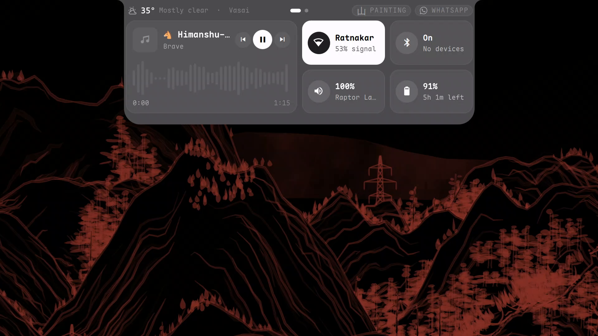

# Island Flight

A Dynamic Island for [Omarchy](https://omarchy.org), where windows fly out of the island.

Turns Omarchy's top bar into a phone-style **Dynamic Island**: a small pill with the time that opens into pages
for music, Wi-Fi, Bluetooth, sound, battery, Claude Code usage, system stats and quick toggles. Notifications,
volume and brightness appear inside it, and apps fly out of it when they open.



Walkthrough video and the full setup: [omarchy-dotfiles](https://github.com/Himanshu-MlSHRA/omarchy-dotfiles)

## Install

```sh
omarchy plugin add https://github.com/Himanshu-MlSHRA/omarchy-dynamic-island
omarchy bar use io.github.himanshu-mlshra.dynamic-island
```

Then click the island at the top of the screen.

**Optional keyboard shortcut** (`SUPER + B` to open it, `Tab` / arrows to flip pages, `Esc` to go back). Add this to
`~/.config/hypr/bindings.lua`:

```lua
hl.unbind("SUPER + B")
o.bind("SUPER + B", "Dynamic Island", "omarchy-shell -q omarchy.bar island toggle")
hl.define_submap("island", function()
  hl.bind("ESCAPE", hl.dsp.exec_cmd("omarchy-shell -q omarchy.bar island back"))
  hl.bind("SUPER + B", hl.dsp.exec_cmd("omarchy-shell -q omarchy.bar island toggle"))
  hl.bind("TAB", hl.dsp.exec_cmd("omarchy-shell -q omarchy.bar island page:next"))
  hl.bind("SHIFT + TAB", hl.dsp.exec_cmd("omarchy-shell -q omarchy.bar island page:prev"))
  hl.bind("RIGHT", hl.dsp.exec_cmd("omarchy-shell -q omarchy.bar island page:next"))
  hl.bind("LEFT", hl.dsp.exec_cmd("omarchy-shell -q omarchy.bar island page:prev"))
end)
```

**Volume and brightness inside the island:** `omarchy plugin disable omarchy.osd`

**Notifications only in the island** (not also in the corner) and menus that grow out of it: use the one-line
installer from [omarchy-dotfiles](https://github.com/Himanshu-MlSHRA/omarchy-dotfiles#install), which adds the companion plugins.

**Turn off the flying windows:** put `{ "windowFlight": false }` in `~/.config/omarchy/island.json`.

## Remove

```sh
omarchy bar reset
omarchy plugin remove io.github.himanshu-mlshra.dynamic-island
```

If you added the shortcut block, delete it from `~/.config/hypr/bindings.lua`. If you disabled the OSD,
run `omarchy plugin enable omarchy.osd`.

## Requirements

- Omarchy 4 (the Quickshell shell). Made on Omarchy 4.0 with Hyprland 0.56.
- Nothing extra to install: it uses NetworkManager, bluez, brightnessctl, jq and ImageMagick, which all come with Omarchy.
- Optional: the [Maple Mono NF](https://github.com/subframe7536/maple-font) font (`omarchy pkg aur add maplemono-nf`) for the clock. Without it your monospace font is used.

## Credits

Built on Omarchy's own bar plugin (MIT). `PDotText.qml` and `PFlipText.qml` are from
[Panacea](https://github.com/EnsixD/Panacea) by EnsixD (MIT). Look inspired by Panacea and
[Atoll](https://github.com/Ebullioscopic/Atoll).

MIT licensed.
